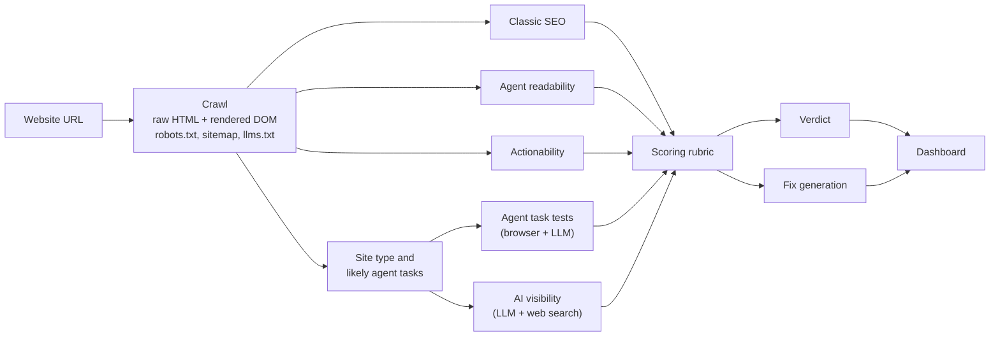

# AgentRank

**See your website the way AI agents do.**

More and more searching, comparing, booking and buying is done by AI agents: ChatGPT, Claude and Perplexity
answering questions, and browser agents clicking through sites on someone's behalf. Most websites are built
for people and for Google, not for them. AgentRank audits a website for classic SEO **and** for AI agents,
tells you whether agent optimisation matters for that site, and writes the fixes.

For each site it answers four questions:

| Question | How AgentRank finds out |
| --- | --- |
| Can agents **read** it? | Crawls up to 25 pages twice (raw HTML and rendered with a real browser), checks AI-crawler access in robots.txt, llms.txt, structured data, how much content exists without JavaScript, and whether prices, hours and contact details can be extracted. |
| Can agents **use** it? | Checks form labels, CAPTCHAs, login and bot walls, content locked in images, and machine interfaces (OpenAPI, MCP). Then an LLM browser agent actually tries the site's key tasks and records every step with a screenshot. |
| Do AI assistants **recommend** it? | Writes the questions customers ask, puts them to AI models with web search, and records whether the site is named or linked, and which competitors are recommended instead. |
| How is its **classic SEO**? | Titles, descriptions, headings, canonicals, broken links, sitemap coverage, indexability and mobile speed (PageSpeed Insights). |

Then it gives a **verdict** (Critical / Recommended / Low priority, with the reasons), an **Agent-Ready score**
with the estimated score after fixes, and **ready-to-paste fixes**: llms.txt, JSON-LD, robots.txt, sitemap.xml,
meta tags and accessibility fixes, each linked to the problem it solves.

## Features

- **Projects**: group sites per client or brand, each with its own audit history and average score
- **Agent replays**: a filmstrip of what the test agent saw at every step, and where it got stuck
- **AI visibility**: mention, citation and share-of-voice rates with 95% ranges, per model, and the sites recommended instead
- **Transparent scoring**: every score lists the checks behind it; the rubric is versioned (`/rubric`)
- **3D site map** of the crawled pages, coloured by how readable each page is without JavaScript
- **Accounts**: sign-up and sign-in; audits are private to their owner
- **Command palette** (Ctrl/Cmd + K): paste a URL to audit it, or jump to any project or site

## How it works



The test agent is safe to point at real businesses: its browser blocks every form submission except
add-to-cart, so it never sends a booking, order, payment or message. For a booking task, "success" means it
reached a filled form ready to submit. The crawler respects robots.txt and identifies itself as `AgentRankBot`.

## Tech stack

| Part | Built with |
| --- | --- |
| API | Python 3.12, FastAPI, SQLAlchemy (SQLite by default, Postgres optional) |
| Crawling and agent | Playwright (Chromium), httpx, BeautifulSoup |
| LLM | Any OpenAI-compatible API; set up for [Groq](https://console.groq.com) (`openai/gpt-oss-120b`, free tier) |
| Jobs | In-process by default; Celery + Redis optional |
| Dashboard | Next.js 15, React 19, three.js via React Three Fiber, Phosphor icons |

## Run it locally

### What you need

- [Python 3.12+](https://www.python.org/downloads/) and [uv](https://docs.astral.sh/uv/getting-started/installation/)
- [Node.js 20+](https://nodejs.org/)
- A free [Groq API key](https://console.groq.com/keys)

### 1. Backend (API on port 8000)

```sh
cd backend
uv sync                                   # install Python dependencies
uv run python -m playwright install chromium
cp .env.example .env                      # then put your Groq key in backend/.env
uv run uvicorn app.main:app --port 8000
```

API docs are at http://localhost:8000/docs.

### 2. Dashboard (port 3000)

In a second terminal:

```sh
cd frontend
npm install
npm run dev
```

Open http://localhost:3000, create an account, and paste a website address to run your first audit.
An audit takes about 5 to 10 minutes; results fill in stage by stage.

> On Windows, use `copy .env.example .env` instead of `cp`.

### Optional: Postgres and Redis

The default setup needs no Docker: SQLite stores the data and audits run inside the API process. For
Postgres plus a Redis-backed Celery worker:

```sh
docker compose up -d                      # Postgres and Redis
# uncomment the three Postgres/Redis/queue lines in backend/.env, then in backend/:
uv run uvicorn app.main:app --port 8000
uv run celery -A app.worker worker --pool=solo --loglevel=info   # a second terminal
```

## Configuration

All backend settings live in `backend/.env`; [`backend/.env.example`](backend/.env.example) lists every
option with its default. The ones you are most likely to change:

| Setting | Default | What it does |
| --- | --- | --- |
| `GROQ_API_KEY` | (none) | Required for classification, agent tests, AI visibility and written fixes |
| `AGENTRANK_LLM_MODEL` | `openai/gpt-oss-120b` | Model for structured calls; `AGENTRANK_LLM_BASE_URL` switches provider |
| `AGENTRANK_MAX_PAGES` | `25` | Pages crawled per audit |
| `AGENTRANK_AGENT_RUNS_PER_TASK` | `2` | Agent runs per task (the rubric calls for 3 when budget allows) |
| `AGENTRANK_VISIBILITY_PROMPTS` | `6` | Customer questions asked per model |
| `AGENTRANK_PAGESPEED_API_KEY` | (none) | Optional; keyless PageSpeed requests are often rate-limited |
| `AGENTRANK_COOKIE_SECURE` | `false` | Set to `true` when serving over HTTPS |

The dashboard reads `AGENTRANK_API_URL` (default `http://localhost:8000`); see
[`frontend/.env.example`](frontend/.env.example).

### LLM budget

Groq's free tier allows 8K tokens per minute and 200K per day for each model. A full audit uses roughly
50 to 130K tokens, so expect one to three full audits per model per day. Per-minute limits are waited out;
when a model's daily quota runs out, structured calls fall back to `openai/gpt-oss-20b` and AI visibility
skips that model (recorded on each answer), so audits still finish. Lower the settings above to stretch it.

## Tests

```sh
cd backend
uv run pytest
```

The suite covers the crawler, every check module, scoring, the verdict, fix generation, the LLM client's
rate-limit handling, the agent's submission guard, accounts and projects. It runs offline.

## Project layout

```
backend/
  app/
    main.py          API routes (audits, projects, accounts, rubric)
    pipeline.py      runs an audit: crawl, checks, agent tests, visibility, verdict, fixes
    crawler/         polite crawler: raw + rendered pages, robots.txt, sitemaps, site files
    modules/         seo, readability, actionability, agent_tests, visibility, classify
    scoring.py       rubric v0.1 and the Agent-Ready score
    verdict.py       "do you need this?" priority and projected scores
    fixes.py         ready-to-paste fixes
    llm.py           OpenAI-compatible client with rate-limit handling
    auth.py          scrypt passwords, session cookies
  tests/
frontend/
  app/               Next.js routes: projects, audits, audit detail, rubric, login, register
  components/        dashboard UI, charts, 3D globe and site map
  lib/api.ts         typed API client
docker-compose.yml   optional Postgres and Redis
```

## Limitations

- Scores follow a first, versioned rubric (v0.1) and are meant to be explained, not taken as ground truth.
  Standards such as llms.txt and MCP are still forming.
- AI answers vary from run to run; visibility rates come with ranges for that reason.
- Some sites block automated browsers. That is reported as a finding rather than worked around.
- Screenshots and crawled HTML are served from `/storage` by unguessable audit IDs, not behind sign-in.

## Roadmap

- Competitor comparison: audit two or three rival sites side by side
- Scheduled re-audits with alerts, and score history charts
- PDF and white-label reports for agencies
- Generated MCP server or OpenAPI starter for a site's key actions
- Google Search Console connection for real impressions and positions
